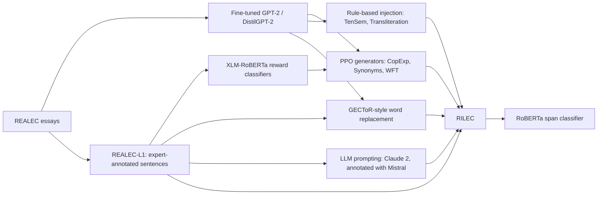

# RILEC: Russian L1 Interference Learner English Corpus

### Detection and Generation of L1 Russian Interference Errors in English Learner Texts (LREC 2026)

📚 [Dataset](https://huggingface.co/datasets/Zlovoblachko/RILEC) • 🤗 [Models](#models) • 📃 [Paper](https://aclanthology.org/2026.lrec-1.848/) • 📄 [arXiv](https://arxiv.org/abs/2603.07366)

Many errors in student essays come from the writer's first language: a Russian speaker may write *stadion* for *stadium* because of the Russian word *stadion*. Grammatical error detection tools can flag such a word, but they do not explain where the error came from.

RILEC is a dataset for detecting these errors in English essays by Russian-speaking learners. It combines expert-annotated sentences from the [REALEC](https://realec.org) learner corpus with synthetic sentences from rule-based and neural augmentation, labelled with five interference error types. This repository contains the code that generated the synthetic data. The corpus and the models are on Hugging Face.



## Table of Contents

- [Error Types](#error-types)
- [Data](#data)
- [Models](#models)
- [Quick Start](#quick-start)
- [Results](#results)
- [Responsible Use](#responsible-use)
- [Acknowledgement](#acknowledgement)
- [Citation](#citation)
- [License](#license)

## Error Types

The tagset derives from Weinreich's analysis of language interference. Examples are from the paper, with the Russian source in brackets where the paper gives one.

| Label | Abbreviation | What it covers | Example |
| --- | --- | --- | --- |
| `Copying expression` | CopExp | Word-for-word translation of a Russian expression or collocation | \*A big bath was prepared for **every of us**. (*dla kazhdovo iz nas*) |
| `Synonyms` | Syn | Choosing the wrong English word for a Russian word that covers several English meanings | \*The distance can be **overcame** by the train. (*preodolena*) |
| `Tense semantics` | TenSem | An English tense misused because of the corresponding Russian form | \*In 1999 the share **decreases**. |
| `Transliteration` | Transl. | A Russian word written in the English alphabet | \*And often a lot of money comes to the **cassa**. (*kassu*) |
| `Word form transmission` | WFT | A Russian grammatical category carried over into English | \*The primary cost was $5 **billions**. |

## Data

### RILEC on Hugging Face

[`Zlovoblachko/RILEC`](https://huggingface.co/datasets/Zlovoblachko/RILEC) contains four tab-separated files without header rows. Each row has three fields: `label`, `span` and `sentence`.

| File | Contents | Labelled rows |
| --- | --- | --- |
| `All_aug - full.tsv` | The full dataset, from all sources below | 19,171 |
| `GPT_errorifier - full.tsv` | PPO and rule-based generations, plus REALEC sentences | 8,588 |
| `LLM_errorifier - full.tsv` | LLM-prompted generations, plus REALEC sentences | 2,801 |
| `Rule_based_errorifier - full.tsv` | GECToR-style replacement only, with no REALEC sentences | 5,900 |

The sources break down approximately as follows. The totals differ from `All_aug` by a few rows.

| Source | CopExp | Syn | TenSem | Transl. | WFT | Total |
| --- | ---: | ---: | ---: | ---: | ---: | ---: |
| GECToR-style replacement | 1,131 | 1,232 | 1,198 | 1,180 | 1,158 | 5,899 |
| PPO for CopExp, Syn, WFT; rule-based for TenSem, Transl. | 1,209 | 1,205 | 1,748 | 893 | 1,490 | 6,545 |
| LLM prompting | 216 | 198 | 119 | 36 | 223 | 792 |
| Manually annotated sentences | 1,016 | 577 | 638 | 936 | 714 | 3,881 |
| REALEC sentences | 389 | 790 | 507 | 149 | 214 | 2,049 |

Before using the files, note the following:

- **Non-data rows.** `All_aug`, `GPT_errorifier` and `LLM_errorifier` each contain a stray row whose first field is not a label. The loader in [Load the Data](#load-the-data) removes them.
- **No predefined split.** The files are not divided into train and test. The combined files also contain sentences from the REALEC-L1 test set below, so remove those before evaluating on it. The loader section shows how.

### REALEC-L1 test set

[`Zlovoblachko/L1_true_errors`](https://huggingface.co/datasets/Zlovoblachko/L1_true_errors) holds the 2,204 rows of real learner data used for evaluation, in `real_errors.tsv`. This file has a header row: `Label`, `Error`, `Sentence`.

## Models

All models are on Hugging Face under [`Zlovoblachko`](https://huggingface.co/Zlovoblachko).

### Detector

[`en_stellar_butterfly`](https://huggingface.co/Zlovoblachko/en_stellar_butterfly) is the main interference error detector: a spaCy span classifier on RoBERTa-base that labels spans of one to three tokens with the five error types.

The model needs spaCy 3.4, which conflicts with `requirements.txt`, so install it in a separate Python 3.10 environment:

```bash
pip install torch==2.2.2 spacy==3.4.4 spacy-transformers==1.2.1 huggingface_hub "numpy<2"
```

Load it from a Hub snapshot, because current versions of pip reject the filename of the wheel in the model repository:

```python
import spacy
from huggingface_hub import snapshot_download

nlp = spacy.load(snapshot_download("Zlovoblachko/en_stellar_butterfly"))

for text in ["In 1999 the share decreases.", "The primary cost was $5 billions."]:
    doc = nlp(text)
    print([(span.text, span.label_) for span in doc.spans["sc"]])
# [('decreases', 'Tense semantics')]
# [('billions', 'Word form transmission')]
```

### Generators and Reward Classifiers

The notebooks were anonymized for review, so they use placeholders in place of model names. This table gives the mapping.

| Model | Purpose | Placeholder in notebooks |
| --- | --- | --- |
| [`GPT2_L1_sent_generator`](https://huggingface.co/Zlovoblachko/GPT2_L1_sent_generator) | GPT-2 fine-tuned on REALEC | `MODEL_PATH` (GPT-2 notebook) |
| [`test_L1_sent_generator`](https://huggingface.co/Zlovoblachko/test_L1_sent_generator) | DistilGPT-2 fine-tuned on REALEC; the base model for PPO | `MODEL_PATH` (PPO notebook), `FINETUNED_DISTILGPT_PATH` |
| [`L1-classifier-CopExp`](https://huggingface.co/Zlovoblachko/L1-classifier-CopExp) | Reward classifier | `COPEXP_CLASSIFIER_PATH` |
| [`L1-classifier-Synonyms`](https://huggingface.co/Zlovoblachko/L1-classifier-Synonyms) | Reward classifier | `SYNONYMS_CLASSIFIER_PATH` |
| [`L1-classifier-TenSem`](https://huggingface.co/Zlovoblachko/L1-classifier-TenSem) | Reward classifier | `TENSEM_CLASSIFIER_PATH` |
| [`L1-classifier-Transliteration`](https://huggingface.co/Zlovoblachko/L1-classifier-Transliteration) | Reward classifier | `TRANSLITERATION_CLASSIFIER_PATH` |
| [`L1-classifier-WFT`](https://huggingface.co/Zlovoblachko/L1-classifier-WFT) | Reward classifier | `WFT_CLASSIFIER_PATH` |
| [`CopExp_L1_sent_generator`](https://huggingface.co/Zlovoblachko/CopExp_L1_sent_generator) | PPO generator, used in RILEC | |
| [`Synonyms_L1_sent_generator`](https://huggingface.co/Zlovoblachko/Synonyms_L1_sent_generator) | PPO generator, used in RILEC | |
| [`WFT_L1_sent_generator`](https://huggingface.co/Zlovoblachko/WFT_L1_sent_generator) | PPO generator, used in RILEC | |
| [`TenSem_L1_sent_generator`](https://huggingface.co/Zlovoblachko/TenSem_L1_sent_generator) | PPO generator, excluded from RILEC | `PPO_TRAINED_TEMSEM_GENERATOR_PATH` |
| [`Transliteration_L1_sent_generator`](https://huggingface.co/Zlovoblachko/Transliteration_L1_sent_generator) | PPO generator, excluded from RILEC | |

The TenSem and Transliteration generators are excluded because they did not reliably produce their target errors in manual review. RILEC uses rule-based generation for those two types instead.

To sample from a generator:

```python
from transformers import pipeline

generator = pipeline("text-generation", model="Zlovoblachko/Synonyms_L1_sent_generator")
generator("It can be seen", do_sample=True, max_new_tokens=25, num_return_sequences=2)
```

Loading a generator prints a warning about unused `v_head` weights. This is expected, because the value head is only needed for PPO training.

## Quick Start

### Setup

The requirements target Python 3.10.

```bash
git clone https://github.com/harlamovads/RILEC.git
cd RILEC
pip install -r requirements.txt
```

The pins are needed because the notebooks use APIs that later releases changed or removed, such as `trl.PPOTrainer` and `evaluation_strategy`.

### Load the Data

`load_dataset("Zlovoblachko/RILEC")` fails, because the files have no headers and Hugging Face reads each file's first row as different column names. Load the files with pandas instead:

```python
import csv
from urllib.parse import quote

import pandas as pd

BASE = "https://huggingface.co/datasets/Zlovoblachko/RILEC/resolve/main/"
LABELS = {"Copying expression", "Synonyms", "Tense semantics",
          "Transliteration", "Word form transmission"}

def load_rilec(name="All_aug - full.tsv"):
    df = pd.read_csv(BASE + quote(name), sep="\t", header=None, usecols=[0, 1, 2],
                     names=["label", "span", "sentence"], quoting=csv.QUOTE_NONE,
                     encoding="utf-8")
    return df[df["label"].isin(LABELS)].reset_index(drop=True)

rilec = load_rilec()  # 19,171 rows
```

To train on RILEC and evaluate on real learner data, remove the test sentences first:

```python
test = pd.read_csv(
    "https://huggingface.co/datasets/Zlovoblachko/L1_true_errors/resolve/main/real_errors.tsv",
    sep="\t",
)
train = rilec[~rilec["sentence"].isin(set(test["Sentence"]))]  # 16,830 rows
```

### Reproduce the Pipeline

The notebooks were written for Google Colab and read data from `/content/`. The input files named below are not included in this repository, so steps 1, 2, 3 and 6 need your own copies. The PPO notebook was run on an NVIDIA A100 GPU. Replace the placeholders using the table in [Generators and Reward Classifiers](#generators-and-reward-classifiers).

| Step | Notebook | Input | Output |
| --- | --- | --- | --- |
| 1 | [`GPT2_initial_finetuning`](notebooks/GPT2_initial_finetuning.ipynb) | `sentences.tsv` | Fine-tuned GPT-2. The same pipeline was used for DistilGPT-2 |
| 2 | [`Classifiers_training`](notebooks/Classifiers_training.ipynb) | `real_train.tsv`, `real_dev.tsv` | Five binary reward classifiers based on XLM-RoBERTa |
| 3 | [`PPO_generator_finetuning`](notebooks/PPO_generator_finetuning.ipynb) | `ppo_training_data.tsv` (the notebook's `DATASET_NAME` stands for a Hub copy of this file), models from steps 1 and 2 | Five PPO generators |
| 4 | [`Tense_semantics_FOE`](notebooks/Tense_semantics_FOE.ipynb) | Fine-tuned generator | Rule-based Tense Semantics errors: past-tense verbs moved to the present in sentences that contain a year |
| 5 | [`Rule_based_transliteration_generation`](notebooks/Rule_based_transliteration_generation.ipynb) | Fine-tuned generator | Rule-based Transliteration errors, using Google Translate |
| 6 | [`Rule_based_sentence_generation`](notebooks/Rule_based_sentence_generation.ipynb) | `span_sentences.tsv` | Replacement dictionaries `L1_replaces_*.p`, one per error type |
| 7 | [`src/errorify/error.py`](src/errorify/error.py) | Dictionaries from step 6, a text file of correct sentences | GECToR-style erroneous sentences |
| 8 | [`RILEC_diversity`](notebooks/RILEC_diversity.ipynb) | The Hugging Face files and `real_errors.tsv` | Diversity metrics, including Self-BLEU, MAUVE and 3-gram novelty |

For step 7, put the `L1_replaces_*.p` files in `src/errorify/`, and create the output directory first. The script reads the dictionaries from the current directory.

```bash
cd src/errorify
mkdir -p output
python error.py sentences.txt output
```

This writes `corr_sentences.txt` and `incorr_sentences.txt` to `output/`. Each changed word is marked in the output, as in `**persons** (Synonyms)`. [`src/errorify/examples/`](src/errorify/examples/) holds sample sentence pairs from an earlier run, without these markers.

Two steps are not scripted here. The prompts for LLM generation and annotation are in §4.3 of the paper. The span classifier settings are in §5.1: spaCy span classification on RoBERTa-base, with a batch size of 128, a threshold of 0.5 and ten epochs.

## Results

These F1 scores (%) are reported in Table 5 of the paper, for RoBERTa models fine-tuned on each data subset and evaluated on the REALEC-L1 test set. The best score in each column is in bold.

| Training data | CopExp | Syn | TenSem | Transl. | WFT | Average |
| --- | ---: | ---: | ---: | ---: | ---: | ---: |
| Base (REALEC-L1) | 15.79 | 46.60 | 75.44 | 83.33 | 57.14 | 55.66 |
| GPT-based | 21.62 | **79.25** | **82.14** | 92.31 | 83.72 | 71.81 |
| Rule-based | 31.82 | 61.40 | 77.06 | 84.62 | 75.00 | 65.98 |
| LLM-based | **41.03** | 72.16 | 78.85 | 92.31 | 71.43 | 71.16 |
| RILEC (all sources) | 33.33 | 69.39 | 80.00 | **96.55** | **90.48** | **73.95** |

Word-level types (Transliteration, Word Form Transmission, Tense Semantics) score highest. Copying Expression and Synonyms remain harder.

## Responsible Use

RILEC covers IELTS-style essays by Russian-speaking learners, and the paper does not evaluate generalization to other L1s or genres. The models are intended for education and research to identify L1-specific error patterns. They are not intended for grading or assessment, and automated error detection should be used with human oversight. The generation methods should not be used to fabricate learner data or responses on learning platforms.

## Acknowledgement

- [REALEC](https://realec.org) is the source learner corpus.
- [PIE](https://github.com/awasthiabhijeet/PIE) is the source of `error.py` and of the code adapted in `errorifier.py`.
- [GECToR](https://github.com/grammarly/gector) inspired the replacement-based augmentation.
- [TRL](https://github.com/huggingface/trl) provides the PPO implementation.
- [spaCy](https://spacy.io) provides the span classification pipeline.

## Citation

```bibtex
@inproceedings{kharlamova-proskurina-2026-rilec,
    title = "{RILEC}: Detection and Generation of {L}1 {R}ussian Interference Errors in {E}nglish Learner Texts",
    author = "Kharlamova, Darya  and
      Proskurina, Irina",
    editor = "Piperidis, Stelios  and
      Bel, N{\'u}ria  and
      van den Heuvel, Henk  and
      Ide, Nancy  and
      Krek, Simon  and
      Toral, Antonio",
    booktitle = "Proceedings of the Fifteenth Language Resources and Evaluation Conference",
    month = may,
    year = "2026",
    address = "Palma de Mallorca, Spain",
    publisher = "ELRA Language Resource Association",
    url = "https://aclanthology.org/2026.lrec-1.848/",
    doi = "10.63317/5bas35hntskv",
    pages = "10826--10837"
}
```

## License

The RILEC corpus is tagged MIT on Hugging Face. `src/errorify/error.py` and `src/errorify/errorifier.py` derive from PIE, which is MIT-licensed; see [`src/errorify/LICENSE.PIE`](src/errorify/LICENSE.PIE). REALEC has its own terms, described at [realec.org](https://realec.org).
